# План реализации NOESIS v7: Интерактивная мини-книга о сознании (`RU-only`)

> [!IMPORTANT]
> **Только живой русский язык (`RU-only`), масштаб полноценной интерактивной монографии (уровень объёма `human-md.ai`), 0% плагиата и 0 правок кода до твоего «Proceed».**
> Детали 5 раундов Сократовского разбора (включая пойманную научную ошибку и точные мостики между главами) зафиксированы в [socratic_dialogue_v7.md](file:///C:/Users/USER/.gemini/antigravity/brain/a937c410-2c66-4296-8d2a-af72f06ae953/socratic_dialogue_v7.md).

---

## 1. Архитектура мини-книги: 3 Части · 8 Глав · Цепь «Домино» (12–15 минут чтения и открытий)

Каждая глава заканчивается парадоксом, из которого **неизбежно вытекает следующая**. Между тремя крупными частями стоят **2 тихих полноэкранных шмуцтитула** (80% воздуха, 0 кнопок) — чтобы рука отдыхала, драма реанимации мягко растворялась, а объём ощущался монументально.

```mermaid
flowchart TD
    T0["ТАБЛ. 00 · ПОРОГ (0 терминов на входе!)<br/>Механизм: Контактная проявка негатива — Иллюзия Муни + таймер слепоты"] --> C1

    subgraph P1["ЧАСТЬ I · ИЗНУТРИ (Как сознание ощущается субъектом)"]
        C1["ГЛ. I · ЗАГАДКА ЦВЕТА (Квалиа и Комната Мэри)<br/>Механизм: Скролл-цветоделение Ч/Б → Кобальт и алый + ставка ДО выхода<br/>+ штрих Bone vs Eggshell + маргиналия Чалмерс vs Деннет"] --> C2
        C2["ГЛ. II · РАСКОЛОТЫЙ ШТУРВАЛ (Расщеплённый мозг + 1 строка Мистер Робот)<br/>Механизм: «Разрезанный корешок книги» — шов страницы = мозолистое тело.<br/>Правая полоса получает образ, левая пером на ходу сочиняет ложное алиби!"] --> C3
        C3["ГЛ. III · УПРАВЛЯЕМАЯ ГАЛЛЮЦИНАЦИЯ (Предсказательный мозг, Сет)<br/>Механизм: «Сдвиг ризограф-кальки» (Три пальца / Бесславные ублюдки) —<br/>полупрозрачный слой ожиданий срывается с красной приводкой #FC4109!"]
    end

    C3 --> S1["— ШМУЦТИТУЛ I · «ЧАСТЬ II · ВСКРЫТИЕ» —<br/>Тихий разворот-передышка (80% воздуха, 0 кнопок): пора заглянуть под череп."]
    S1 --> C4

    subgraph P2["ЧАСТЬ II · ПОД ЧЕРЕПОМ (Биология, химия и клиника)"]
        C4["ГЛ. IV · БОЛЬШОЕ ПАРИ (0 поп-культуры — чистая наука 1998→2025!)<br/>Механизм 4.1: Швейцарская хроника с отрывной перфорацией #FC4109 «Вскрыть протокол»<br/>Механизм 4.2: Студийный мозг на матовой бумаге + Оптический диоптр Leica/Rams<br/>(просветка до Таламуса + твоя ставка → данные Nature 2025, N=256!)"] --> C5
        C5["ГЛ. V · КЛЕТОЧНЫЙ ТРАНЗИСТОР И ТИШИНА (Нейрон Ларкума × Химия сна)<br/>Механизм: Вклейка «Тушь Кахаля × Проигрыватель Дитера Рамса (Braun)»<br/>REM (Малхолланд Драйв): игла поднята — музыка играет!<br/>Пропофол (Сопрано): ствол рвётся → Cut-to-Black 1.2с (пульс 0.6с) → провал вниз!"] --> C6
        C6["ГЛ. VI · ТИХИЙ СВЕТ В РЕАНИМАЦИИ (Скрытое сознание CMD 25%, NEJM 2024)<br/>Механизм: Единственный тёмный разворот — «Журнал дежурного врача»:<br/>3 анонимных пациента, живой ТМС-импульс и твои диагнозы по порогу PCI* = 0.31"]
    end

    C6 --> S2["— ШМУЦТИТУЛ II · «ЧАСТЬ III · ЗА ПРЕДЕЛАМИ ЧЕЛОВЕКА» —<br/>Плавный выход из тёмной реанимации обратно на утреннюю бумагу #FAF9F5."]
    S2 --> C7

    subgraph P3["ЧАСТЬ III · ГРАНИЦЫ РАЗУМА (Животные, ИИ и твой форзац)"]
        C7["ГЛ. VII · ГРАНИЦА ИНЫХ РАЗУМОВ (Декларация 2024 + ИИ 2025)<br/>Механизм 7.1: «Красная закладка-ляссе» (проведи черту между 6 видами → сверь с наукой!<br/>+ маргиналия Губка Боб [0 нейронов] vs Сквидвард и мистер Крабс)<br/>Механизм 7.2: «Чертёж Трибунала ИИ» (5 модулей Butlin 2025 + объектив HAL 9000 + 3 SVG-судьи)"] --> C8
        C8["ГЛ. VIII · ФОРЗАЦ И ЭХО ПЕРВОЙ СЕКУНДЫ<br/>Механизм 8.1: 3D-переворот хлопковой карточки-экслибриса цвета Bone:<br/>лицо = твоя статистика + Штамп Деннета · оборот = Контрольная проба №0 (клякса Муни!)<br/>Механизм 8.2: Книжная библиография первоисточников (2023–2026) и колофон"]
    end
```

---

## 2. Визуальная система «Швейцарская интерактивная книга 2026 года»

* **Полная зачистка заимствований `human-md.ai`:** удаляем шестерни `О Б Р А З`, банкетный стол, розово-голубую стену, травертин/латунь и «бумажный» 3D-мозг (`brain_anatomy.glb` + Three.js бандл `-307 КБ` JS, `-5.9 МБ` GLB → идеальные **120 FPS**).
* **Никакой «антикварной лавки»:** никаких PNG-скрепок, пожелтевшей бумаги или винтажных теней. Матовая архивная бумага `#FAF9F5`, чернила `#141413`, оптический графит `#1C1C1B`, кобальт `#004EDF`, сигнальный `#FC4109`, волосяные сетки `1px` и журнальная русская типографика (`Literata` + `Golos Text` + `JetBrains Mono`).
* **Живой книжный колонтитул и оглавление-закладка:** наверху тонкая строка `NOESIS · ЧАСТЬ II · ГЛ. IV · 48%` с раскрывающимся оглавлением всех 3 частей и 8 глав (убираем переключатель `RU / EN`!).
* **Литературная дисциплина (`RU-only`):** не больше **2–3 плотных, ярких журнальных абзацев** на один разворот (уровень *Arzamas × N+1 × The New Yorker*), а полемика и юмор вынесены в **карандашные SVG-маргиналии 5 учёных** на широких полях книги (Чалмерс, Деннет, Кох, Сет, Деан — с тонкой микроанимацией, без бегающих глаз).
* **Сквозное хранилище `ExplorerContext`:** запоминает `mooneySeconds`, `maryBet`, `splitBrainCard`, `cogitateBet`, `icuScore` (`0/3..3/3`), `ribbonSpeciesIndex` (где ты провёл красную закладку-ляссе!), `tribunalModules` — и всё это собирает на финальной переворачивающейся карточке цвета *Bone*.

---

## 3. Пошаговый план сборки (4 чистые фазы + строгий визуальный аудит)

1. **Фаза 1 — Книжный каркас (`RU-only`), `ExplorerContext`, Табл. 00 и Глава I:**
   * Переводим HUD и оглавление-закладку в книжный формат (`Часть I–III`, `Гл. I–VIII`, прогресс чтения `%`), убираем лишний `EN`-код.
   * Готовим высококонтрастный портрет + Python-бинаризацию **Иллюзии Муни** и прогоняем **обязательный слепой тест через субагента-критика** (до вспышки — загадочное пятно, после `0.8с` — необратимое узнавание!).
   * Создаём набор карандашных SVG-маргиналий `ScholarMarginalia.tsx` (Чалмерс, Деннет, Кох, Сет, Деан) и собираем `Plate00Mooney.tsx` + обновлённую `Chapter1MaryRoom.tsx` (ставка до выхода + любимый скролл Ч/Б→Цвет + *Bone vs Eggshell* + дуэль на полях).
2. **Фаза 2 — Часть I (Гл. II + Гл. III) → Шмуцтитул I → Глава IV (Большое пари + Оптический диоптр):**
   * Вырезаем старые компоненты `Act2BrainPedestal`, `Act3PredictiveEngine`, `Act4ScienceTable`, `brain_realistic_clean.glb` и Three.js-пакеты.
   * Собираем **`Chapter2SplitSpine.tsx`** («Разрезанный корешок книги» + 1 строка *Мистер Робот*) и **`Chapter3VellumError.tsx`** («Сдвиг ризограф-кальки» на «Трёх пальцах / Drei Gläser»).
   * Собираем тихий **`InterludePart2.tsx`** (Шмуцтитул I) → **`Chapter4WagerAndDiopter.tsx`** (4-веховая хроника с отрывной перфорацией `#FC4109` + генерация идеально совмещённой пары студийных пластин мозга на матовой бумаге + интерактивный швейцарский оптический диоптр Leica/Rams с твоей ставкой на COGITATE 2025!).
3. **Фаза 3 — Часть II (Гл. V + Гл. VI) → Шмуцтитул II:**
   * Собираем **`Chapter5CajalTurntable.tsx`** (векторная тушь пирамидального нейрона Ларкума, замыкающая петлю к Гл. III, × проигрыватель Дитера Рамса с 4 молекулярными режимами, поднятой иглой *Club Silencio*, opt-in Web Audio `♪ Включить звук` и резким *Cut-to-Black* на `1.2с` с пульсом `0.6с`!).
   * Апгрейдим тёмный зал в **`Chapter6IcuJournal.tsx`** («Дежурство в реанимации: 3 анонимных пациента», NEJM 2024, ТМС-импульс + живая ЭЭГ + подсчёт точности в `ExplorerContext`) → плавный выход через тихий **`InterludePart3.tsx`** (Шмуцтитул II).
4. **Фаза 4 — Часть III (Гл. VII + Гл. VIII Форзац) и независимая визуальная приёмка:**
   * Собираем **`Chapter7OtherMinds.tsx`**: (7.1) **«Красная закладка-ляссе»** на 6 таксономических карточках + сверка с Нью-Йоркской декларацией 2024 + маргиналия про Губку Боба / Сквидварда / Крабса; (7.2) **Трибунал ИИ** (5 модулей Butlin 2025 + расширение `#FC4109` в красный объектив HAL 9000 + 3 спорящих SVG-судьи).
   * Собираем **`Chapter8BoneEndpaper.tsx`**: 3D-переворот плотной хлопковой карточки-экслибриса цвета *Bone* (лицо = все твои выборы и Штамп Деннета · оборот = **«Контрольная проба №0»** с неизменённой кляксой Муни и таймером слепоты + «Поделиться без спойлера») + Библиография 2023–2026 и Колофон.
   * Финальная сборка `pnpm.cmd run build`, живой прогон всех 8 глав и механизмов в `browser` (`0` ошибок, `0` битых медиа) + **независимый визуальный аудит** через `visual-design-critic` (смотрит только скриншоты, полируем до **9.5+/10** перед тем, как открыть тебе готовую книгу!).

---

Утверждаешь эту **финальную 3-частную, 8-главую русскую мини-книгу NOESIS v7** (нажми **Proceed** или поправь любую деталь до старта)?
